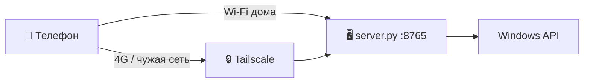

<div align="center">

# ⚡ Пульт ПК Хост

**Программа для ПК к приложению «Пульт ПК» — управляй Windows-компьютером с телефона**


[](https://github.com/Fersiya/PhoneV2-server/actions/workflows/build-installer.yml)

[📱 Приложение для телефона](https://github.com/Fersiya/PhoneV2) · [⬇️ Скачать APK](https://github.com/Fersiya/PhoneV2/releases/latest)

</div>

---

## ✨ Что умеет

| | Возможность |
|---|---|
| 🖥️ | Трансляция экрана (MJPEG, до частоты монитора), чёткий зум без потери качества, выбор монитора |
| 🔊 | Звук ПК на телефон (WASAPI loopback, лёгкий режим для интернета) |
| 🖱️ | Мышь по UDP (125 Гц), клавиатура, ввод текста, буфер обмена |
| 🎵 | Громкость, плеер, пульт YouTube в Brave |
| 🪟 | Окна и программы: запуск, закрытие, свернуть, на передний план |
| ⚡ | Выключение, сон, рестарт, блокировка, таймеры |
| 📁 | Проводник файлов ПК, скачивание и загрузка фото с телефона |
| 🔒 | Вне дома — через [Tailscale](https://tailscale.com) (бесплатно); приложение само выбирает путь |
| 🔄 | Обновление приложения по воздуху (OTA) |
| 🔔 | Иконка в трее: токен, адреса, сопряжение одним кликом |

## 🚀 Установка (2 минуты)

1. ⬇️ Скачай **[PCControl-Setup.exe](https://github.com/Fersiya/PhoneV2-server/releases/latest)** и запусти. Python ставить не нужно.
2. Установщик сам добавит программу в автозагрузку и откроет порт 8765 в брандмауэре только для домашней сети.
3. Появится окно «Пульт ПК» (потом открывается двойным кликом по значку ⚡ у часов).
4. 📱 Установи [приложение](https://github.com/Fersiya/PhoneV2/releases/latest), подключи телефон к той же Wi-Fi и нажми **Опции → «Найти ПК в Wi-Fi»**. Токен подтянется сам, пока окно на ПК открыто.

> 🔒 Каждый, кто ставит программу, получает **собственный** Хост на своём ПК и свой токен. Моего сервера нигде нет — все данные остаются у тебя.

### 🛠️ Для разработчиков (из исходников)

```bat
git clone https://github.com/Fersiya/PhoneV2-server.git
cd PhoneV2-server
python server.py
```

Для режима «вне дома» установи [Tailscale](https://tailscale.com/download) на ПК и телефон и войди в один аккаунт. (Cloudflare-туннель убран, код сохранён в ветке `archive/cloudflare-tunnel`.)

## 🔄 Обновления

- 📱 **Приложение:** Хост сам раз в 6 часов скачивает свежий APK из [релиза PhoneV2](https://github.com/Fersiya/PhoneV2/releases/latest) в папку `updates/`; на телефоне — «Опции → Обновления → Проверить на ПК».
- 🖥️ **Сервер:** в окне программы кнопка «⬆ Обновления» проверяет новый релиз и ставит его в один клик.

## 🗺️ Как это работает



- 🏠 **Дома** телефон ходит напрямую по IP — быстрее и без лишних задержек.
- 🔒 **Вне дома** приложение подключается к ПК по его Tailscale-адресу (его Хост сообщает при сопряжении).

## 🔐 Безопасность

- 🔑 Доступ по токену (`X-Token`), сравнение через `hmac.compare_digest`.
- 🚫 10 неверных токенов → IP блокируется на 15 минут.
- 🤝 Токен телефону выдаётся **только в домашней сети и только пока открыто окно сопряжения** (5 минут после двойного клика по значку), один раз. Через Tailscale — никогда.
- 🙈 Токен не пишется в лог.
- 🛡️ Защита от DNS rebinding (проверка заголовка `Host`), от Path Traversal и UNC-путей в проводнике.
- 📤 Загрузка принимает только фото/видео, имена файлов очищаются.
- ⚠️ По HTTP/UDP токен идёт открытым текстом — не пробрасывай порт 8765 на роутере в интернет, для внешнего доступа используй Tailscale.

## ⚙️ Настройки (`config.json`)

Создаётся при первом запуске, в git не попадает.

| Ключ | Что делает |
|---|---|
| `token` | Секретный токен доступа |
| `apps` | Список программ для запуска |

♻️ **Сменить токен:** закрой Хост, удали строку `token` в `%LOCALAPPDATA%\PCControl\config.json` (из исходников — `config.json` рядом с `server.py`), запусти Хост — появится новый. Затем в приложении «Опции → Найти ПК в Wi-Fi».

## 🧩 Структура

```
server.py          точка входа
installer/         установщик (Inno Setup) и иконка
server/version.py  версия Хоста: подними — и CI выпустит новый релиз
server/            пакет: winapi, capture, input, handler, network, tray, auth, ota…
tests/             модульные тесты (python -m unittest discover tests)
install_autostart.bat   автозагрузка + правила брандмауэра
sync_github.bat         commit → pull --rebase → push (без force)
```

## 🔄 Синхронизация с GitHub

Запусти `sync_github.bat`: он спросит текст коммита, подтянет изменения через `git pull --rebase` и отправит их. Принудительный push не используется — ничего не затрётся.
