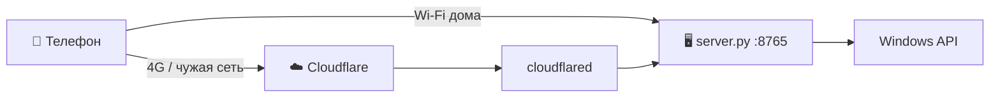

<div align="center">

# ⚡ PhoneV2 Server

**Серверная часть «Пульта ПК» — управляй Windows-компьютером с телефона**


[📱 Приложение для телефона](https://github.com/Fersiya/PhoneV2) · [⬇️ Скачать APK](https://github.com/Fersiya/PhoneV2/releases/latest)

</div>

---

## ✨ Что умеет

| | Возможность |
|---|---|
| 🖥️ | Трансляция экрана (MJPEG до 60 FPS), выбор монитора |
| 🖱️ | Мышь по UDP (125 Гц), клавиатура, ввод текста, буфер обмена |
| 🎵 | Громкость, плеер, пульт YouTube в Brave |
| 🪟 | Окна и программы: запуск, закрытие, свернуть, на передний план |
| ⚡ | Выключение, сон, рестарт, блокировка, таймеры |
| 📁 | Проводник файлов ПК, скачивание и загрузка фото с телефона |
| 🌐 | Cloudflare-туннель — управление вне дома, **без Tailscale и VPN** |
| 🔄 | Обновление приложения по воздуху (OTA) |
| 🔔 | Иконка в трее: токен, адреса, туннель одним кликом |

## 🚀 Быстрый старт

1. Установи [Python 3.10+](https://www.python.org/downloads/) (галочка *Add to PATH*).
2. Клонируй репозиторий и запусти:
   ```bat
   git clone https://github.com/Fersiya/PhoneV2-server.git
   cd PhoneV2-server
   python server.py
   ```
3. Для фоновой работы и автозагрузки запусти `install_autostart.bat` **от имени администратора**.
4. Для режима «вне дома» положи рядом [`cloudflared.exe`](https://github.com/cloudflare/cloudflared/releases) (или установи его в Windows).
5. Открой приложение на телефоне в той же Wi-Fi сети → **«Найти ПК в сети Wi-Fi»** — токен подтянется сам.

Двойной клик по иконке ⚡ в трее покажет адрес, токен и состояние туннеля.

## 🗺️ Как это работает



- 🏠 **Дома** телефон ходит напрямую по IP — быстрее и без лишних задержек.
- 🌐 **Вне дома** адрес туннеля сервер публикует в облачный канал, приложение берёт его само.

## 🔐 Безопасность

- 🔑 Доступ по токену (`X-Token`), сравнение через `hmac.compare_digest`.
- 🚫 10 неверных токенов → IP блокируется на 15 минут (за туннелем учитывается реальный IP).
- 🤝 Выдача токена кнопкой (`/api/pair`) работает **только в домашней сети** — через туннель токен не отдаётся.
- 🛡️ Защита от DNS rebinding (проверка заголовка `Host`), от Path Traversal и UNC-путей в проводнике.
- 📤 Загрузка принимает только фото/видео, имена файлов очищаются.
- ⚠️ По HTTP/UDP токен идёт открытым текстом — не пробрасывай порт 8765 на роутере в интернет, для внешнего доступа есть туннель (HTTPS).

## ⚙️ Настройки (`config.json`)

Создаётся при первом запуске, в git не попадает.

| Ключ | Что делает |
|---|---|
| `token` | Секретный токен доступа |
| `apps` | Список программ для запуска |
| `tunnel_autostart` | `true` (по умолчанию) — туннель стартует вместе с сервером, `false` — только по кнопке |

## 🧩 Структура

```
server.py          точка входа
server/            пакет: winapi, capture, input, handler, network, tray, auth, ota…
tests/             модульные тесты (python -m unittest discover tests)
install_autostart.bat   автозагрузка + правила брандмауэра
sync_github.bat         commit → pull --rebase → push (без force)
```

## 🔄 Синхронизация с GitHub

Запусти `sync_github.bat`: он спросит текст коммита, подтянет изменения через `git pull --rebase` и отправит их. Принудительный push не используется — ничего не затрётся.
